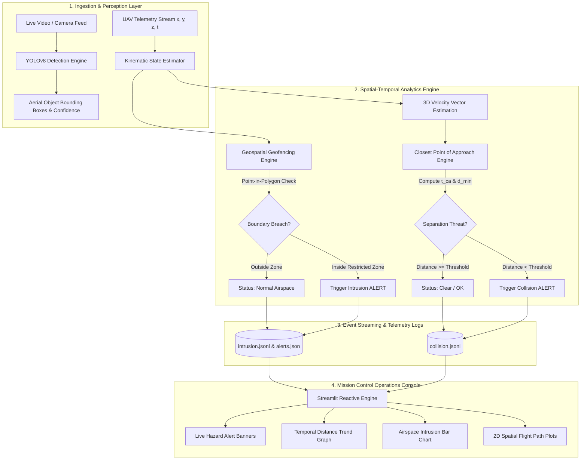

<div align="center">

# 🚁 AI-Driven UAV Collision & Intrusion Detection System
### *Autonomous Airspace Deconfliction, Deep Learning Perception & Geospatial Geofencing*

[](https://www.python.org/)
[](https://ultralytics.com)
[](https://streamlit.io/)
[](https://opencv.org/)
[](https://opensource.org/licenses/MIT)


[Key Capabilities](#-key-capabilities) •
[System Architecture](#-system-architecture) •
[Kinematic Math & Algorithms](#-kinematic-formulation--conflict-algorithms) •
[Mission Control UI](#-mission-control--visual-analytics) •
[Quickstart Guide](#-quickstart--installation) •
[Technical Highlights](#-resume--engineering-highlights) •
[Author & Contact](#-author--contact)

---

</div>

## 📌 Executive Summary

As low-altitude airspace becomes increasingly crowded with commercial delivery drones, autonomous inspection UAVs, and hobbyist aircraft, the risk of **mid-air collisions** and **unauthorized incursions into restricted airspace** grows exponentially. Traditional Air Traffic Management (ATM) relying on transponders and ground radar is ill-suited for dense, low-altitude Unmanned Traffic Management (UTM).

The **AI-Driven UAV Collision & Intrusion Detection System** is an end-to-end, edge-ready UTM solution engineered to ensure safe airspace coexistence. By unifying **real-time deep learning computer vision (YOLOv8)**, **3D predictive relative kinematics (Closest Point of Approach - CPA)**, and **computational geometry geofencing (Point-in-Polygon)**, this system continuously detects aerial threats, forecasts collision risks before they happen, and alerts operators through a reactive **Streamlit Mission Control Console**.

---

## ⚡ Key Capabilities

| Capability | Technical Implementation | Impact / Outcome |
| :--- | :--- | :--- |
| **Vision-Based Aerial Perception** | YOLOv8 Deep Convolutional Neural Network | Real-time aerial object & intruder detection on live video feeds with sub-50ms inference. |
| **Predictive Conflict Detection (CD&R)** | 3D Kinematic Closest Point of Approach (CPA) | Analytically calculates time-to-closest-approach ($t_{ca}$) and minimum separation distance ($d_{min}$) in future trajectory windows. |
| **Dynamic Airspace Geofencing** | Computational Geometry via Shapely (`Point-in-Polygon`) | Enforces custom 2D/3D no-fly zones (NFZs) and triggers microsecond security containment alerts. |
| **Tactical Mission Control Console** | Streamlit Reactive Operations Dashboard | Provides operators with live alerting cards, temporal separation charts, and intrusion frequency analytics. |
| **Resilient Event Streaming & Audit Trails** | Non-blocking structured JSON Lines (`JSONL`) logging | High-throughput logging of collision metrics and security events for post-mission black-box analysis. |

---

## 🏗️ System Architecture

The end-to-end data processing pipeline flows from sensory input and trajectory generation to real-time analysis, alerting, and tactical dashboard visualization:



---

## 📐 Kinematic Formulation & Conflict Algorithms

### 1. 3D Closest Point of Approach (CPA)
To prevent mid-air collisions without relying on external radar, the system calculates the relative kinematics between two UAVs moving with continuous position vectors $\vec{p}_1(t), \vec{p}_2(t)$ and estimated velocity vectors $\vec{v}_1, \vec{v}_2$:

$$\vec{\Delta p} = \vec{p}_1(0) - \vec{p}_2(0)$$

$$\vec{\Delta v} = \vec{v}_1 - \vec{v}_2$$

The relative separation vector as a function of time $t$ is:

$$\vec{d}(t) = \vec{\Delta p} + \vec{\Delta v} \cdot t$$

Squaring the distance gives $D^2(t) = \|\vec{d}(t)\|^2 = \|\vec{\Delta p}\|^2 + 2(\vec{\Delta p} \cdot \vec{\Delta v})t + \|\vec{\Delta v}\|^2 t^2$.

Minimizing $D^2(t)$ with respect to $t$ yields the **Time of Closest Approach ($t_{ca}$)**:

$$t_{ca} = \max\left(0, -\frac{\vec{\Delta p} \cdot \vec{\Delta v}}{\|\vec{\Delta v}\|^2}\right)$$

Evaluating the positions at $t_{ca}$ gives the **Minimum Separation Distance ($d_{min}$)**:

$$d_{min} = \left\| (\vec{p}_1(0) + \vec{v}_1 t_{ca}) - (\vec{p}_2(0) + \vec{v}_2 t_{ca}) \right\|$$

- If $d_{min} < D_{\text{threshold}}$, an immediate **`ALERT`** is broadcast with exact intercept time.
- If $d_{min} \ge D_{\text{threshold}}$, the conflict risk is logged as **`OK`**.

### 2. Computational Geometry Geofencing
Restricted airspace polygons $\Omega \subset \mathbb{R}^2$ are defined via vertex sequences $V = \{v_1, v_2, \dots, v_k\}$. For every telemetry ping $(x_u, y_u)$, the system applies a Jordan curve ray-casting algorithm via `Shapely`:

$$\text{Intrusion}(u) = \begin{cases} 
\text{True} & \text{if } (x_u, y_u) \in \text{Interior}(\Omega) \\
\text{False} & \text{otherwise}
\end{cases}$$

Breaches immediately dispatch structured telemetry to `alerts.json` and `intrusion.jsonl`.

---

## 🖥️ Mission Control & Visual Analytics

### 1. Real-Time Operations Console (Streamlit)
Live dashboard providing automated state polling, severity-coded status cards, and temporal separation tracking.

| Live Status & Trend Analysis | Intrusion Frequency Monitoring |
| :---: | :---: |
|  |  |
| *Real-time collision alert cards & distance-over-time trendline* | *Intrusion frequency over rolling temporal frames* |

### 2. 2D Spatial Airspace Deconfliction & Intrusion Maps
High-resolution kinematic trajectories showing flight paths, restricted no-fly zones, and flagged violation coordinates.

| Kinematic Approach Trajectories | Geofence Boundary Breach Flagging |
| :---: | :---: |
|  |  |
| *2D flight path intersection vectors for UAV 1 & UAV 2* | *Shapely geofence polygon with real-time breach triggers (`x`)* |

---

## 🗂️ Project Structure

```bash
AI-Driven-UAV-Collision-Intrusion-Detection-System/
├── README.md                  # Comprehensive technical documentation & portfolio overview
├── LICENSE                    # MIT Open-Source License
├── documentation.md           # Extended system API & technical specifications
├── yolov8n.pt                 # Pretrained YOLOv8 Nano weights for low-latency detection
│
└── uav-safety/
    ├── streamlit_app.py       # Tactical Mission Control Dashboard (Streamlit)
    ├── requirements.txt       # Core project dependencies & libraries
    │
    ├── scripts/
    │   ├── check_collision.py # 3D CPA kinematic solver & minimum distance predictor
    │   ├── visualize.py       # Shapely geofence intrusion checker & 2D spatial plotter
    │   ├── generate_flights.py# Synthetic 3D flight trajectory generator
    │   ├── dataset.py         # Advanced multi-UAV GPS/altitude telemetry generator
    │   ├── run_yolo_demo.py   # Full YOLOv8 video & image inference pipeline
    │   └── yolo_demo.py       # Lightweight drone/aerial object detector
    │
    ├── data/
    │   ├── flight1.csv        # Telemetry stream for UAV 1 (t, x, y, z)
    │   ├── flight2.csv        # Telemetry stream for UAV 2 (t, x, y, z)
    │   ├── alerts.json        # Structured JSON record of active geofence violations
    │   └── sample.mp4         # Sample video stream for computer vision validation
    │
    ├── logs/
    │   ├── collision.jsonl    # High-frequency conflict logs (timestamps, distances, risks)
    │   └── intrusion.jsonl    # High-frequency geofence security logs (status, IDs, coords)
    │
    └── runs/
        ├── flight_paths.png   # 2D kinematic trajectory output
        ├── paths.png          # Geofence boundary & breach coordinate visualization
        └── detect/            # YOLOv8 annotated video & detection bounding boxes
```

---

## 🚀 Quickstart & Installation

### Prerequisites
- **Python 3.10+**
- **Git**
- Optional: CUDA-compatible GPU (for accelerated YOLO inference)

### 1. Clone & Setup Environment

```bash
# Clone the repository
git clone https://github.com/GajulaRakeshBabu/AI-Driven-UAV-Collision-Intrusion-Detection-System.git
cd AI-Driven-UAV-Collision-Intrusion-Detection-System/uav-safety

# Create and activate virtual environment
python -m venv venv

# On Linux / macOS:
source venv/bin/activate
# On Windows:
venv\Scripts\activate
```

### 2. Install Dependencies

```bash
pip install --upgrade pip
pip install -r requirements.txt
```

### 3. Run the Verification Pipeline

#### A. Run YOLOv8 Perception on Video
```bash
python scripts/run_yolo_demo.py
```
*Processes `data/sample.mp4`, performs neural detection, and outputs annotated video to `runs/detect/`.*

#### B. Synthesize Trajectories & Check 3D Collisions
```bash
python scripts/generate_flights.py
python scripts/check_collision.py
```
*Outputs Closest Approach Time ($t_{ca}$) and Minimum Distance ($d_{min}$) in meters.*

#### C. Perform Geofence Intrusion Detection
```bash
python scripts/visualize.py
```
*Evaluates points against the polygon geofence, writes alerts to `data/alerts.json`, and generates `runs/paths.png`.*

#### D. Launch Streamlit Tactical Dashboard
```bash
streamlit run streamlit_app.py
```
*Open [http://localhost:8501](http://localhost:8501) in your browser to view the live dashboard.*

---

## 🛠️ Tech Stack & Engineering Tools

| Category | Tools & Libraries | Purpose |
| :--- | :--- | :--- |
| **Deep Learning & CV** | `Ultralytics YOLOv8`, `OpenCV` | Real-time object detection, bounding box extraction, video stream parsing. |
| **Computational Geometry** | `Shapely` | Polygon boundary definition, point-in-polygon spatial containment. |
| **Kinematic Modeling** | `NumPy`, `Pandas` | 3D vector algebra, trajectory generation, CPA analytical solver. |
| **Tactical Dashboard** | `Streamlit` | Auto-refreshing reactive UI, live hazard cards, dynamic time-series charts. |
| **Spatial Visualization** | `Matplotlib` | High-fidelity coordinate maps, approach vectors, alert overlays. |
| **Data Streaming** | `JSON Lines (JSONL)` | Low-latency append-only telemetry logging for mission review. |

---

## Highlights

This project demonstrates core competencies across multiple engineering domains:

- **Computer Vision & Deep Learning**: Integrated state-of-the-art YOLOv8 architecture into an automated video inference pipeline, extracting bounding boxes, confidence values, and object classifications.
- **Aerospace & Applied Kinematics**: Implemented real-time relative motion kinematics (Closest Point of Approach) to forecast potential UAV mid-air collisions quantitatively rather than reactively.
- **Computational Geometry & GIS**: Designed dynamic geofencing algorithms using polygonal spatial analysis (`Shapely`), enforcing security zones and no-fly zones (NFZs) with coordinate precision.
- **Full-Stack Tactical Dashboard**: Engineered a reactive, auto-updating operations dashboard in Streamlit that digests asynchronous JSONL log streams to display real-time safety statuses and analytical charts.
- **Software Engineering Best Practices**: Built with clean separation of concerns, modularized analytical scripts, structured JSON/JSONL logging, and comprehensive documentation.

---

## 🔮 Roadmap & Future Enhancements

- [ ] **Extended Kalman Filtering (EKF)**: Integrate sensor fusion (IMU + GPS + Vision) for robust state estimation in noisy environments.
- [ ] **Multi-Agent Swarm Deconfliction**: Scale the CPA algorithm from pairwise UAVs to $N$-UAV swarms using spatial partitioning (KD-Trees/Octrees).
- [ ] **ROS2 / PX4 Autopilot Integration**: Bridge collision warnings directly to MAVLink / PX4 companion computers for automated evasive maneuvers.
- [ ] **Edge Deployment**: Benchmark and package as a lightweight TensorRT engine for NVIDIA Jetson Orin Nano companion computers.

---

## 📜 License

This project is licensed under the **MIT License** - see the [LICENSE](LICENSE) file for full details.

---

## 👨‍💻 Author & Contact

**Gajula Rakesh Babu**  
*AI & Autonomous Systems Enthusiast | Software Engineer*

- **GitHub**: [@GajulaRakeshBabu](https://github.com/GajulaRakeshBabu)
- **Email**: [grakesh2605@gmail.com](mailto:grakesh2605@gmail.com)
- **LinkedIn**: [linkedin.com/in/rakeshbabugajula](https://www.linkedin.com/in/rakeshbabugajula/)

---

<div align="center">

*⭐ If this project provided value to you or your research, consider giving it a star on GitHub!*

</div>
